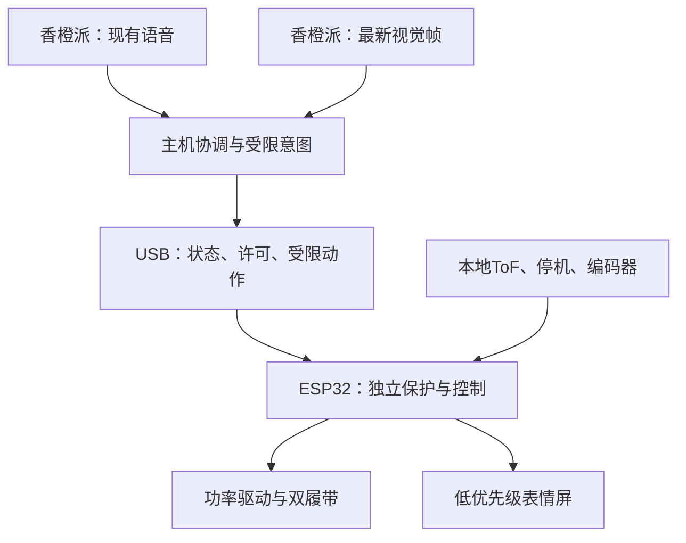
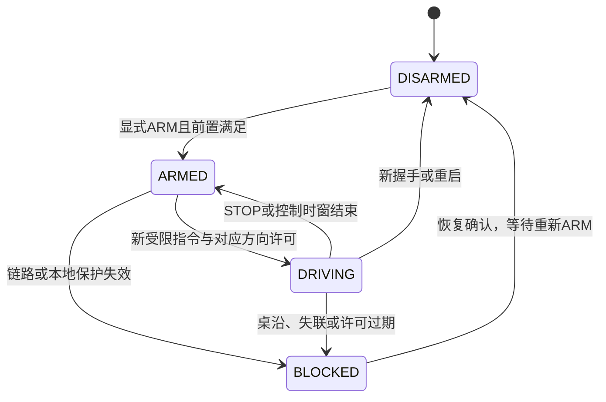

# 摄像头、表情屏、履带与整机集成框架

2026-11-12。主机沿用香橙派4 Pro A733 6GB，实时控制规划用ESP32-S3，显示沿用微雪17344。用户最新明确使用**双履带**，旧双轮清单中的轮组、N20电机、TB6612不能直接当作已选器件。

当前交付是实施步骤、接口契约、算法骨架和可运行的纯软件仿真。没有连接摄像头、ESP32、履带、电池或驱动器；未编译目标ESP-IDF固件，未把现有语音动作接到真实电机。摄像头、屏幕或底盘缺席只禁用对应能力，不阻塞已经可用的语音。

## 1. 先完成哪些事

| 阶段 | 实施与新增交付 | 放行条件 |
|---|---|---|
| F0 当前基础 | 维持离线语音、Naruto、固定回应/结束音、有限音量工具；安装适配A733的主动散热，复测供电 | 唤醒真人统计与温度验证保留。当前短模型测试已触发71.272°C实验停止，不能追加联合满载 |
| F1 通信与状态 | ESP32型号/原理图核验，USB串口握手、双启动ID、心跳、状态同步；先用板载灯 | 断开/重连/重复帧/旧会话不产生动作；未知设备保持运动禁用 |
| F2 表情屏 | 彩条→五态静图→眨眼/嘴形；建立分块刷新与最新状态覆盖 | 240×320方向、色序、字节序正确；拔屏/显示超时不阻塞保护控制 |
| F3 摄像头反馈 | UVC枚举与固定曝光/视场、标记样本回放、连续最新帧采集；先展示画面/状态 | 原始采集时间可验证；旧帧/遮挡/过曝/模糊是UNKNOWN；先不自动驱动履带 |
| F4 履带架空 | 实测底盘/电机/堵转电流，选驱动；编码器方向、单侧低速、双侧混控、停机与反转 | 极性、启动阈值、限流/压降/温度、看门狗与实体停机均实测；真实GPIO适配仍默认关闭 |
| F5 地面围挡 | 低速速度闭环、直行/倒车/原地转向，标定滑移与有效轮距 | 转弯扫掠、左右差速、惯性滑行与制动距离有记录；限速基于实测 |
| F6 桌面防坠 | 各方向ToF覆盖、前向视觉许可、故障注入，系独立防坠绳 | 每个方向单独准入；前摄许可不授权后退/转向；没有足够提前量就禁用 |
| F7 电源与机壳 | 功耗/启动峰值测量→成品保护电池包与匹配充电板→保险/支路→打印装配 | 不先锁定电芯/充电SKU；关机充电优先，边充边用须单独验证负载分配与热 |
| F8 联合与交付 | 语音、视觉、屏幕、履带同时运行；离线冷启动、恢复、回退和记录 | 联合温升/掉帧/最坏停机距离/响应时间达标后才合盖与发布实物能力 |
| F9 可选扩展 | 人物朝向/姿态/物体反馈、特定唤醒硬件、主动导航、联网能力 | 每项独立需求与验收；人脸框不能直接变履带运动，重视觉模型不先加到当前热受限主机 |

阶段是工程顺序，不是学习日/学时安排。购买由用户决定；本框架不把计划、仿真或源文件当作器件已到货或实物已通过。

## 2. 计算与控制怎样分工



香橙派负责语音、可解释的图像结果与用户意图；ESP32独立读传感器、控制使能/速度、处理停机并驱动屏幕。LLM不写PWM、不生成串口JSON、不签发视觉CLEAR。通信、屏幕刷新、日志和模型计算不得阻塞ESP32控制周期。

语音与运动状态机独立：语音依赖就绪后即可聊天；底盘必须另行校准、建立新会话、取得本地许可并显式ARM。故障恢复不重放旧动作。



## 3. 模块与文件

| 文件 | 已有/新建能力 | 尚未实现的实物部分 |
|---|---|---|
| [wire.py](wire.py) | 512字节以内JSONL、CRC32、严格字段/范围、分片粘包与超长行恢复 | pyserial/USB收发适配与ESP32解析器 |
| [supervisor.py](supervisor.py) | 本地时钟、挑战token、心跳/视觉独立到期、去重、方向准入、停机和状态仿真 | ESP-IDF高优先级控制任务、实际传感器和功率使能 |
| [human_intent.py](human_intent.py) | 新动作入口的整句白名单；拒绝问句、否定/引用/条件、LLM来源 | 现有ASR事件到此入口的显式集成与反馈 |
| [motion_math.py](motion_math.py) | 双履带差速公式、共同限幅，单位明确，几何必须显式给出 | 编码器、速度PID、驱动器死区/反转/加减速斜坡 |
| [demo.py](demo.py) | 内存链路与确定性故障演示，默认不启用运动仿真 | 没有真实硬件后端，不能烧录或让机器人行走 |
| [vision_display.md](vision_display.md) | 摄像头采集、视觉三态、用户反馈、屏幕算法与验收规格 | 连续视觉服务、素材固件、硬件SPI/DMA与真实摄像头标定 |
| [tracked_motion.md](tracked_motion.md) | 履带、电机/驱动、电源、传感器覆盖和实车步骤 | 采购、接线、实车速度/滑移/停车距离 |
| [原视觉诊断](../vision_check.py) | 固定参考图的外观对比，输出CLEAR/EDGE/UNKNOWN候选 | 不是通用防坠算法，不能直接独立签发实车许可 |
| [原前进联锁](../forward_guard.c) | 可移植C前向许可内核，已有台架测试 | 只保护前进；需外层协议新鲜度、全方向本地保护和驱动接口 |
| [表情导出](../face_screen.py) | 内置五态PNG/RGB565导出与自备PNG替换 | 真实屏幕方向、色序、内存/刷新时序 |

## 4. 主机—ESP32协议v1

真实字段以`wire.py/SCHEMAS`为准。每行是一个完整UTF-8/ASCII JSON对象加LF，含`v/link/seq/kind/payload/crc32`，最长512字节。CRC32按除`crc32`外的对象进行键排序、紧凑JSON编码后计算；它检测意外损坏，**不提供身份认证**，此版只面向受控本地USB链路。

| 字段/消息 | 契约 |
|---|---|
| 启动与会话 | 双方每次启动生成非零32个十六进制字符（128位）的boot ID；HELLO_ACK回显双方ID并确认从未复用的新link。MCU检查自己的boot回显。Python `begin_session`只是已验证握手后的适配钩子，不自动远程解锁 |
| seq | 每方向独立递增、在实际发送时分配；1…2³¹−1，不回绕。错误/旧会话不续任何许可 |
| poll | MCU签发token，自己的截止时刻固定为签发时刻＋≤200ms。轮询示例100ms、控制tick独立更快；最多保存两个未到期token，避免每tick换token使正常回复饥饿 |
| heartbeat | 必须回显未到期token；只更新链路健康，不能更新视觉许可 |
| vision | `token/frame_id/state/remaining_ms`；CLEAR需新帧ID。EDGE/UNKNOWN用新消息seq撤销，即使引用同一帧ID也应立即停机 |
| move | `token/command_id/action/speed_mm_s/duration_ms`；动作仅FORWARD/REVERSE/LEFT/RIGHT，1…300ms，速度1…100mm/s还受更低的实测上限约束。此速度是每侧履带目标线速度幅值；原地转向中心平移速度仍为零。不是PWM、位移或角度保证 |
| stop | 仅当前会话与消息有效性检查，不需要视觉、ARM或新token；物理停机不经过串口 |
| face | 目前负载只有`state`，MCU在本地映射预置素材；素材ID扩展尚未实现。不在控制串口传RGB565/JPEG，MCU本地blocked/fault优先 |
| ack | 区分accepted、output_applied、completed、aborted/failed；另有模拟专用simulated_stopped。completed必须有实际证据，仿真始终physical_verified=false |

**两个时钟不直接相减。** 主机必须选择在“主机收到本次poll之后”采集的新图像，且检查自己时钟上的帧龄/质量/标定。MCU收回复时只接受本地仍未到期的token，实际许可截止取`min(token原截止, 接收时刻+remaining_ms)`。新token不能包装旧缓存图像，心跳不能续视觉租期。`host_vision_payload`可测试这条时间契约，真实适配还须核对V4L2时钟和SOE/EOF含义。

command_id独立去重：相同ID相同内容只返回缓存状态，不重启计时；相同ID改内容拒绝。缓存淘汰后旧ID仍按最高已见ID拒绝，不能重新执行。回执超时属于结果未知，应STOP/解除ARM并查询/恢复，不能自动换新ID重试。

STOP必须先停，再保留它消耗的命令ID；随后同ID不能变成MOVE。无会话、旧序号等非动作拒绝仅是本地诊断，不发送带null命令ID的ACK。`command_ack()`只将真正的动作回执映射为线上四字段，过滤`cached/local_only`等内部标记。

本地传感器快照有独立`local_input_ms`截止，主控心跳、视觉更新都不能续它；类型错误或缺失有效性会清空缓存健康状态，必须新采有效快照才可恢复。时钟回退另行锁定，需新会话及新本地快照。BLOCKED恢复只回DISARMED，再显式ARM；不能自动续跑。

仿真默认心跳500ms、视觉上限200ms、poll间隔100ms、本地快照100ms、限速20mm/s、单动作≤300ms，都是待实测的初始预算。测试可用其他合法预算隔离故障，不能把测试fixture数值当实物已安全。真正预算必须从传感器采样、链路与控制最坏延迟、履带扫掠和停车距离共同核定。

原C `ForwardGuard`使用接收端本地递增epoch映射会话，不把远程UUID直接强转成整数；所有字段先验证范围再转C类型，避免−1变大无符号数后被截成300ms。

## 5. 各算法怎样推进

| 通路 | 算法骨架与边界 |
|---|---|
| 摄像头反馈 | 固定设备/视场→最新帧单槽→真实采集时间→曝光/模糊/遮挡/标定检查→区域/几何诊断→CLEAR恢复消抖、EDGE/UNKNOWN立即撤销→token绑定许可。人物/物体反馈独立为低优先级界面能力 |
| 屏幕 | 语音状态事件→最新状态覆盖→MCU本地故障优先级→预加载RGB565分块/DMA→低优先级刷新。先静图，再眨眼与口型；不等待模型猜表情，也不阻塞停机 |
| 双履带 | 受限意图→方向覆盖检查→目标速度→差速混控→共同限幅→加减速斜坡→每侧编码器PID→功率驱动；任一步本地否决立即零输出/禁使能。LEFT/RIGHT首版定义为原地转向，未经扫掠覆盖验证始终禁用 |
| 电源与机壳 | 实测启动/堵转/全亮背光/推理功耗→供电支路/保险/欠压与关机→匹配电池及充电→可拆外壳与防振风道→合盖热和拾音复测 |

履带理想模型：\(v_L=v-\omega b_{eff}/2\)，\(v_R=v+\omega b_{eff}/2\)。`b_eff`是需标定的有效轮距，不能用外廓宽度直接代替；履带侧滑使它随地面和负载变化。左右超限共同缩放以保持比例。原地转向时机身中心速度为零，但外角仍扫掠，必须按危险接地点/外角速度、最坏延迟与制动/滑行距离计算提前量。

初始GPIO、底盘尺寸、履带接地长度、质量、电机电压/减速比/堵转电流、编码器、驱动型号、ToF数量/位置、电池串数和风扇接口全部待实物确认。原N20/TB6612与前后各一只ToF不能直接当作履带方案已合格；见分项文档。

## 6. 现在可以运行什么

在`05-projects/desktop-robot`目录，用现有Python环境执行，不打开设备：

```powershell
.\.venv\Scripts\python.exe -X utf8 -m unittest framework.test_wire framework.test_supervisor framework.test_motion_math -v
.\.venv\Scripts\python.exe -X utf8 -m framework.demo
.\.venv\Scripts\python.exe -X utf8 -m framework.demo --enable-simulated-motion --scenario lease-expiry --output .local/framework-demo-lease.jsonl
.\.venv\Scripts\python.exe -X utf8 -m framework.demo --enable-simulated-motion --scenario stop
.\.venv\Scripts\python.exe -X utf8 -m framework.demo --enable-simulated-motion --scenario reconnect
```

默认演示不ARM、不产生DRIVING。显式开启也只在内存模拟：首次前进受理后即使持续心跳，没有新视觉许可，200ms到期仍进入BLOCKED。所有输出`hardware_action=false/physical_verified=false`，不是模拟器证明真实履带已经停轮。结果文件只新建，不覆盖旧证据。

实际固件应基于`esp_timer_get_time()/1000`等64位单调时间，高优先级周期任务持续检查，硬件看门狗和复位默认关使能。Python仿真只在调用tick时推进，不能证明调度最坏延迟；LCD、日志、串口积压和传感器读取阻塞都需要实板故障注入。

## 7. 验收与当前缺口

已执行的结果统一记入[validation.md](validation.md)。需要实物才能确认：摄像头视场/材质和误漏检，SPI方向/色序/刷新，编码器符号、速度误差、反转电流、地面滑移、所有方向防坠提前量、急停与滑行距离、满负载供电、合盖热，以及断网冷启动。

当前语音入口`robot.py`的移动分支只记录模拟动作，原解析会剥问号。未来物理运动必须改接本目录的严格`human_intent`或等价验证：问句“前进？”不能直接变动作；不得直接把模型生成的文字或受理回执接到电机。

下一步从**散热补齐、实际ESP32板卡/屏幕型号核验与F1串口/板载灯**开始。相机与履带实物未确认前，继续使用仿真和标注回放，不虚填针脚、PID参数或可接受停车距离。
